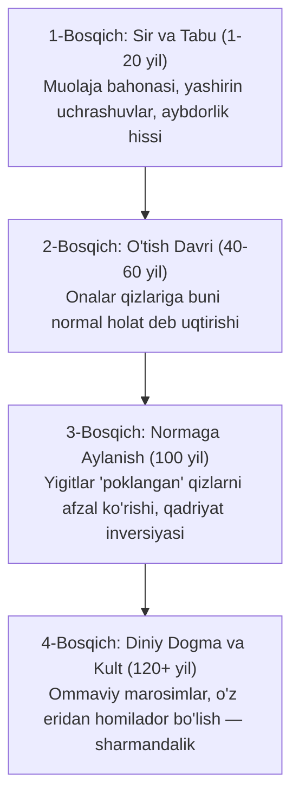

# "Soya Hukmdori" (Cid Asari) va Simulyatsiyalar Koinotining Chuqur Tahlili

Ushbu tahliliy hujjat "Soya Hukmdori (Cid asari)", "5,000 Kishilik Simulyatsiya", "Abadiyat Qafasi (Jackson)", "Frederin" va ularga bog'liq barcha "Lego bloklari" asosida tayyorlangan fundamental adabiy, psixologik va sotsiologik ekspertizadir.

---

## 1. Asarning Falsafiy Konsepti va Janri

### Janr
**Dark Sociological Dystopia (Qorong'u Ijtimoiy Antiutopiya), Psychological Deconstruction (Psixologik Dekonstruksiya) va Totalitarian Social Engineering (Totalitar Ijtimoiy Muhandislik).**

Asar Jorj Oruellning *"1984"*, Oldos Xakslining *"Ajoyib Yangi Dunyo"* va *"The Boys"* serialining ochiq, kinik realizmi elementlarini o'zida birlashtiradi. 

### Fundamental G'oya: "Overton Darchasi"ning Mutlaq Inversiyasi
An'anaviy antiutopiyalarda hokimiyat xalqni qurol, armiya yoki shafqatsiz jazo orqali bo'ysundirsa, Cid asarida hukmronlik **insoniyatning eng nozik, eng intim instinkti — jinsiy ehtiyoj, oila va axloqiy mezonlarni qayta dasturlash** orqali o'rnatiladi.
- Aslida insoniyat tarixida jinoyat va sharmandalik deb bilingan hodisa (xiyonat, or-nomussizlik) bu asarda bosqichma-bosqich **eng oliy fazilat, diniy burch va jamiyat sharafiga** aylantiriladi.
- Bu sotsiologiyadagi "Overton Darchasi" (fikrni qabul qilib bo'lmas darajadan qonuniy normaga aylantirish) konsepsiyasining eng radikal va mukammal badiiy namoyishidir.

---

## 2. Bosh Qahramon (Cid) Psixologik Portreti va Fojiasi

### Boshlang'ich Nuqta va Travma
- **Onaning xiyonati:** Cidning butun xatti-harakatlari bolalikdagi og'ir ruhiy jarohatga — o'z onasining xiyonat qilib tashlab ketishiga borib taqaladi.
- **Nihilizm va Fosh Qilish Fiksatsiyasi:** U ayollardan shunchaki jismoniy qasos olmaydi. Uning maqsadi ancha qorong'uroq: u dunyodagi barcha ayollarning "poklik", "sadoqat" va "dindorlik" niqoblarini yirtib tashlashni, ularning barchasi tub mohiyatida nafsga, qudratga va qulaylikka tobe ekanligini o'ziga va butun dunyoga isbotlashni xohlaydi.
- **Passiv-Aggressiv Dominantlik:** Cid o'zini zo'ravondek tutmaydi. U o'zini ojiz, beozor bola qilib ko'rsatadi, ammo ayolning ichki zaif nuqtasi (eridan ko'ngli to'lmaslik, maishiy zerikish, moliyaviy muammo) ochilishi bilan o'zgaradi va uni psixologik tobe qiladi.

### Qahramonning Falsafiy Bo'shlig'i
Cid — an'anaviy ma'nodagi yovuz emas, u hissiz "laboratoriya xodimi"dir. U butun jamiyatni, insoniy munosabatlarni, hatto o'z urug'ini ham o'zining ruhiy tajribasi uchun xomashyo deb biladi. Uning fojiasi shundaki, barcha ayollarni o'ziga tobe qilib, jamiyatni to'liq manqurtlashtirgandan so'ng ham uning ichki qalb jarohati bitmaydi — chunki u qidirgan "haqiqiy sadoqat" endi bu dunyoda umuman mavjud emas, uni Cidning o'zi butunlay yo'q qildi.

---

## 3. Jamiyat Qadriyatlarining Evolyutsiyasi (Xronologik Dinamika)

Asarning eng kuchli qismi — normalarning bir kechada emas, balki **avlodlar almashinuvi orqali tabiiy evolyutsiya qilishi** ko'rsatilganidadir:

### Bosqichma-bosqich Tahlil:
1. **0 – 20 yillar (Taqiqlangan Zino va Sir):**
   Xiyonat dastlab an'anaviy axloq doirasida yashirin kechadi. "Shifokor ko'rigi", "farzand ko'rishga yordam", "erning qarzini to'lash" kabi utilitarian bahonalar orqali vijdon tinchlantiriladi. Ayollar hissizlik va dissotsiatsiyani o'zlashtiradi.
2. **60 – 100 yillar (Ijtimoiy Sharaf):**
   Onasi Cid orqali hayotda yutuqqa erishgan qizlar katta bo'ladi. Onalar o'z qizlarini erga berishdan oldin bu yo'ldan o'tkazadi. Erkaklar ham "Cid urug'i" tekkan qizlarni yuqori toifali, barakali deb hisoblay boshlaydi. Erkaklarning g'ururi yo'q qilinib, "ijtimoiy maqom" bilan almashtiriladi.
3. **120+ yillar (Absolyut Kult va Teskari Axloq):**
   Cid tirik xudoga aylanadi. Oila instituti jismoniy sevgidan ajratilib, ma'muriy-iqtisodiy yacheykaga aylanadi. O'z eridan homilador bo'lish — eng tuban sharmandalik, Cid orqali homilador bo'lish esa fuqarolik mukofotiga aylanadi.

---

## 4. Tizim Mexanizmlari va Simulyatsiya Modellarining O'zaro Aloqasi

Asarlar papkasidagi qolgan fayllar ushbu koinotning turli burchaklarini to'ldiruvchi mexanizmlardir:

| Asar / Fayl | Roli va Vazifasi | Tizimdagi O'rni |
|---|---|---|
| **Soya Hukmdori (Cid)** | Asosiy fundamental koinot | Psixologik, maishiy va diniy normalarning teskari o'zgarishi |
| **5,000 Kishilik Simulyatsiya** | Texnologik va logistik yechim | Klonlash, sanoat kastasi (A, B, C), VR va ommaviy axborot monopoliyasi |
| **Abadiyat Qafasi (Jackson)** | Yopiq oroldagi biologik model | 1 erkakli jamiyatda genetik qaramlik va kengash boshqaruvi |
| **Frederin (Qirollik)** | Siyosiy manipulyatsiya modeli | Erkak siyosatchilarni ularning ayollari orqali boshqarish sxemasi |
| **Free God** | Meta-darajadagi falsafa | Koinotga shunchaki "Lego o'yini" va simulyatsiya sifatida qarovchi Yaratuvchi nigohi |
| **deep_analysis_100_300** | Mikro-mexanikalar katalogi | Erning ko'z o'ngida xiyonat, maktab amaliyotlari, hissizlik psixologiyasi |

---

## 5. Kritik Tahlil: Kuchli Tomonlar va Mantiqiy Zaifliklar (Plot Holes)

### Asarning Kuchli Tomonlari:
1. **Psixologik Haqiqatgo'ylik:** Xarakterlarning hissizlashuvi (dissotsiatsiya) va jinoyat sherigiga aylanishi orqali vijdonning o'lishi fashistik va totalitar tizimlardagi real psixologiyaga juda mos keladi.
2. **Murakkab Sotsial Inversiya:** Yaxshilik va yomonlik tushunchalarini shunchaki inkor qilmay, ularning o'rniga to'liq mantiqiy teskari tizim qurilgan.
3. **Logistika Yechimlari:** 5000 kishiga bir kishi qanday ulgurishi masalasi klonlar (soyalar) orqali mantiqan yopilgan.

### Asarning Mantiqiy Zaifliklari (Plot Holes) va Tavsiyalar:

1. **Erkaklar Qarshiligining To'liq Yo'qligi:**
   - *Muammo:* Tabiiy testosteron va biologik rashk instinktini faqat targ'ibot bilan 100% yo'qotib bo'lmaydi. Birorta erkakning shubhalanmasligi yoki isyon qilmasligi asarning realizmini susaytiradi.
   - *Tavsiya:* Suvga yoki oziq-ovqatga qo'shiladigan gormonal susaytiruvchi vosita (masalan, tajovuzkorlikni so'ndiruvchi kimyoviy preparat) haqida kanonga qo'shimcha kiritilsa, bu teshik to'liq yopiladi.
2. **Genetik Birxillik (Inbreeding) Xavfi:**
   - *Muammo:* Agar barcha bolalar Cidning urug'idan tug'ilsa, 3-4 avloddan keyin butun shahar bir-biriga aka-singil va ota-bola bo'ladi. Haqiqiy biologiyada bu qattiq genetik mutatsiyalar va o'limga olib keladi.
   - *Tavsiya:* Kanonda qayd etilgan "Cidning urug'i mutatsiyani yo'qotadi" degan sehrli qoidani gen muhandisligi yoki klonlash xonasidagi sun'iy DNK tozalash tizimi bilan asoslash lozim.
3. **Dramatik Qarshilik (Antagonist) Yetishmasligi:**
   - *Muammo:* Agar hamma osonlikcha rozi bo'lsa va Cid doim g'alaba qozonsa, hikoya o'zining dramatik tarangligini (suspense) yo'qotadi.
   - *Tavsiya:* Jamiyat ichida yashirin, fosh qilinmagan haqiqiy "Tabiiy Er-Xotin" (tizimga qarshi yashirin sevgi) liniyasi qo'shilsa, asar klassik adabiy durdonaga aylanadi.

---

## 6. Xulosa

"Soya Hukmdori" loyihasi — bu shunchaki erotik yoki provokatsion asar emas. Bu inson tabiati, jamiyat institutlarining omonatligi va agar axloq poydevori buzilsa, insoniyat qanchalik osonlik bilan manqurtlashishi mumkinligini ko'rsatib beruvchi o'ta shafqatsiz va chuqur **Ijtimoiy Dystopiya**dir.
